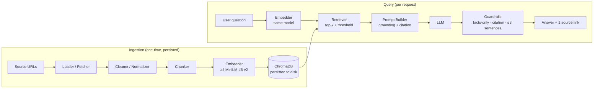
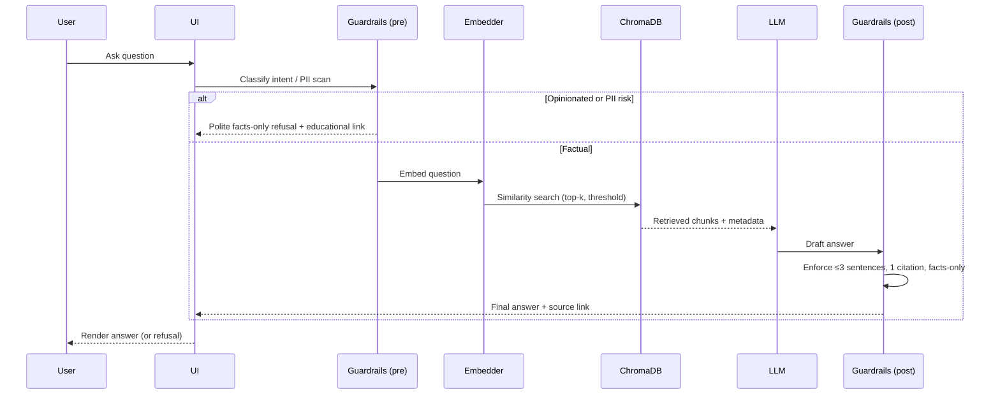

# Architecture — Mutual Fund FAQs (Facts-Only Q&A RAG Chatbot)

**Status:** Draft
**Companion doc:** `Prd.md`
**Last updated:** 2026-10-12

---

## 1. Purpose

This document describes the technical architecture for the facts-only mutual fund FAQ assistant defined in `Prd.md`. It covers:

- The end-to-end **RAG pipeline** (ingestion + query).
- Component responsibilities and data flow.
- The **tech stack**, chunk metadata schema, and persistence model.
- Guardrails that enforce citations, facts-only answers, refusals, and PII safety.
- A proposed module layout, configuration, and ingestion strategy.

The assistant answers questions using **only the provided source data** and cites **one official link** in every factual answer.

---

## 2. Architecture at a Glance



**Two-phase design:** ingestion runs once and persists to disk; query reuses the persisted store, so restarts don't re-embed.

---

## 3. Components

### 3.1 Ingestion Pipeline

`Load → Chunk → Embed → Store in Vector DB`

| Stage | Component | Responsibility |
|-------|-----------|----------------|
| Load | **Fetcher/Loader** | Retrieve the scoped public pages (AMC/SEBI/AMFI) and normalize them to clean text. |
| Chunk | **Chunker** | Split cleaned text into overlapping, metadata-rich chunks. |
| Embed | **Embedder** | Encode each chunk to a 384-dim vector with `sentence-transformers/all-MiniLM-L6-v2`. |
| Store | **Vector Store** | Upsert chunk text + embedding + metadata into ChromaDB persisted on disk. |

### 3.2 Query Pipeline

`Question → Embed → Retrieve top chunks → LLM → Answer`

| Stage | Component | Responsibility |
|-------|-----------|----------------|
| Embed | **Embedder** | Encode the user question with the **same** model used at ingestion. |
| Retrieve | **Retriever** | Similarity search over ChromaDB; return top-k chunks above a score threshold. |
| Generate | **Prompt Builder + LLM** | Build a grounded prompt from retrieved chunks and produce a factual answer. |
| Guard | **Guardrails** | Enforce facts-only, one citation, ≤ 3 sentences, refusal behavior, PII checks. |

### 3.3 Presentation

| Component | Responsibility |
|-----------|----------------|
| **UI** | Welcome line + 3 example questions + note "Facts-only. No investment advice." + answer area with a single citation link. |
| **Disclaimer** | Persistent disclaimer snippet rendered in the UI. |

---

## 4. Tech Stack

| Concern | Choice | Notes |
|---------|--------|-------|
| Embedding model | `sentence-transformers/all-MiniLM-L6-v2` | Local, no API key, **384-dim** vectors; same model for chunks and questions. |
| Vector DB | **ChromaDB** | Persisted to disk; ingestion runs once, not on every restart. |
| Ingestion runtime | Python script | Runs the offline pipeline and writes persisted store + chunk dump. |
| Retrieval | Chroma similarity search | Top-k with score threshold. |
| Generation (LLM) | Configurable | Any grounded LLM; must be constrained by the guardrails layer. |
| UI | Lightweight (notebook or small web app) | Prototype-level; 3 example questions + answer panel. |

---

## 5. Data Model

### 5.1 Chunk Metadata Schema

Each chunk stored in ChromaDB keeps metadata to support citation, filtering, and freshness.

| Field | Type | Purpose |
|-------|------|---------|
| `chunk_id` | string | Stable unique ID. |
| `scheme` | string | e.g., `HDFC Large Cap Fund – Direct Growth`. |
| `category` | string | e.g., `Large Cap`, `Flexi Cap`, `ELSS`, `Small Cap`, `Balanced Advantage`. |
| `doc_type` | string | `factsheet`, `KIM/SID`, `scheme FAQ`, `fee/charges`, `riskometer/benchmark`, `statement/tax-doc guide`. |
| `source_url` | string | Official link used for the **single citation** in answers. |
| `source_title` | string | Human-readable page title. |
| `last_updated` | date | Source/page date used for "Last updated from sources: …". |
| `text` | string | Chunk content (also stored as the document body). |
| `position` | int | Order of the chunk within its source document. |

### 5.2 Chunking Strategy (proposed)

Per `Prd.md`, the agent inspects the data first, then proposes a strategy. Proposed default:

- **Chunk size:** ~500–800 characters (tuned after inspecting page structure), grouped by **semantic section** (e.g., "Exit Load", "Expense Ratio") where headings exist.
- **Overlap:** ~10–20% to preserve context across boundaries.
- **Metadata:** the schema in §5.1, so each chunk is independently citable and filterable by scheme/category.
- **Inspection artifact:** all chunks written to a human-readable **`.txt`** file for review before embedding.

---

## 6. Query Flow (Sequence)



---

## 7. Guardrails & Compliance

| Guardrail | Enforcement point | Behavior |
|-----------|-------------------|----------|
| **One citation per answer** | Post-generation | Every factual answer must contain exactly one `source_url` from retrieved metadata. |
| **Facts-only / refusal** | Pre- and post-generation | Detect opinionated/portfolio intent (e.g., "Should I buy/sell?") and return a polite facts-only message + relevant educational link. |
| **No performance claims** | Pre- and post-generation | Block return computation/comparison; link to the official factsheet if asked. |
| **No PII** | Pre-generation | Reject/avoid handling PAN, Aadhaar, account numbers, OTPs, emails, phone numbers; never store them. |
| **Conciseness** | Post-generation | Cap answers at ≤ 3 sentences. |
| **Freshness** | Post-generation | Append "Last updated from sources: " using `last_updated` metadata. |
| **Public sources only** | Ingestion | Restrict corpus to AMC/SEBI/AMFI pages; no third-party blogs, no back-end screenshots. |

---

## 8. Persistence & Lifecycle

- ChromaDB persists to a local directory (e.g., `./chroma_db/`) so ingestion is **idempotent** and run **once**.
- Re-ingestion is explicit (manual trigger) when sources change or the corpus is updated.
- The chunk `.txt` dump and persisted vector store are the artifacts connecting ingestion to query.

---

## 9. Proposed Module Layout

```
Growwchat/
├── Prd.md
├── architecture.md
├── README.md
├── Docs/
│   └── Problemstatement.txt
├── data/
│   ├── sources.md            # Source list (5 URLs) — deliverable
│   └── raw/                  # Loaded/normalized source pages
├── ingest/
│   ├── load.py               # Fetch/normalize sources
│   ├── chunk.py              # Chunking + metadata
│   ├── embed.py              # all-MiniLM-L6-v2 encoding
│   └── store.py              # ChromaDB upsert + persistence
├── query/
│   ├── retrieve.py           # Embed question + top-k search
│   ├── generate.py           # Prompt builder + LLM call
│   └── guardrails.py         # Citation, refusal, PII, length, freshness
├── ui/
│   └── app.py                # Welcome line + 3 examples + disclaimer
├── artifacts/
│   └── chunks.txt            # Inspectable chunk dump
├── chroma_db/                # Persisted vector store
└── sample_qa.md              # Sample Q&A — deliverable
```

---

## 10. Configuration

| Key | Example | Purpose |
|-----|---------|---------|
| `EMBEDDING_MODEL` | `sentence-transformers/all-MiniLM-L6-v2` | Must match at ingest + query. |
| `VECTOR_DB_PATH` | `./chroma_db` | ChromaDB persistence directory. |
| `COLLECTION_NAME` | `mf_faq` | Chroma collection. |
| `CHUNK_SIZE` / `CHUNK_OVERLAP` | tuned after inspection | Chunking parameters. |
| `TOP_K` / `SCORE_THRESHOLD` | e.g., `5` / configurable | Retrieval breadth and relevance cutoff. |
| `LLM_PROVIDER` / `LLM_MODEL` | configurable | Generation backend. |

---

## 11. Non-Functional Requirements

- **Traceability:** every factual answer is traceable to an official source via one citation link.
- **Reproducibility:** same embedding model at ingest and query; deterministic chunk metadata.
- **Efficiency:** embedding/ingestion happens once; query path avoids re-embedding the corpus.
- **Safety:** PII never accepted or stored; advice/performance queries refused.
- **Inspectability:** chunk dump in `.txt` allows review of what the model retrieves from.

---

## 12. Mapping to PRD Requirements

| PRD item | Architecture location |
|----------|-----------------------|
| RAG ingestion + query pipeline (§6 PRD) | §3, §6 |
| Embedding model + 384-dim (§6.3 PRD) | §4, §5.2 |
| Chunking strategy + `.txt` dump (§6.3 PRD) | §5.2, §9 |
| ChromaDB persisted (§6.3 PRD) | §4, §8 |
| One citation per answer (§5.1 PRD) | §7 |
| Refusal of opinionated questions (§5.1 PRD) | §6, §7 |
| Tiny UI + disclaimer (§5.1 PRD) | §3.3, §7 |
| Constraints: public sources, no PII, no performance claims, ≤3 sentences (§7 PRD) | §7 |
| Deliverables (§8 PRD) | §9 |

---

## 13. Open Questions

1. Which LLM backend will generate answers (hosted API vs. local model)?
2. Is the prototype a notebook or a small hosted web app?
3. Final chunk size/overlap after data inspection.
4. Source pages: scrape live at ingest time, or store snapshots under `data/raw/`?
5. Exact `TOP_K` and similarity threshold for the refusal/fallback boundary.
